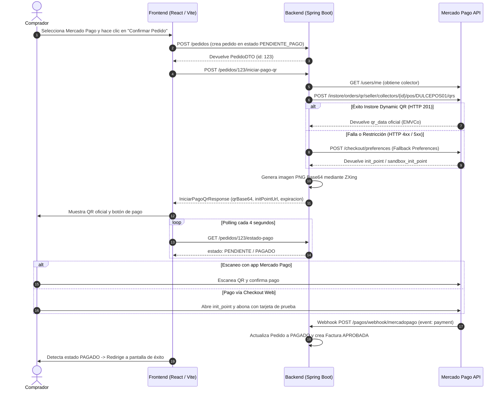

# Documentación Técnica: Integración de QR Dinámico y Fallback con Preferences en Mercado Pago

**Proyecto:** Dulce Mayor  
**Fecha:** Noviembre 2026  
**Rama:** `tincho`  
**Autores:** Equipo de Desarrollo / Antigravity Agentic Pair  

---

## 1. Resumen Ejecutivo y Objetivos

El objetivo de esta integración es proveer un flujo de cobro moderno, robusto y tolerante a fallos para la opción de pago con billetera virtual (**Mercado Pago**).

Se implementó una **estrategia de cobro híbrida y resiliente de 3 niveles**:
1. **Nivel Primario (QR Dinámico Presencial - In-Store POS API)**: Generación del código QR dinámico oficial de Mercado Pago mediante la API `/instore/orders/qr/seller/collectors/{userId}/pos/{externalPosId}/qrs`. El código generado es estándar EMVCo interoperable y puede ser escaneado directamente desde la app de Mercado Pago o billeteras bancarias habilitadas.
2. **Nivel Secundario (Fallback a Mercado Pago Checkout Preferences)**: Si la cuenta colectora o el entorno de pruebas experimenta restricciones en la venta presencial por QR físico, el sistema conmuta automáticamente a la API `/checkout/preferences`. Esta API devuelve una URL oficial de pago (`init_point` / `sandbox_init_point`), a partir de la cual el backend genera un código QR estándar escaneable y el frontend ofrece un botón directo de redirección.
3. **Nivel Terciario (Fallback Offline / Mock EMVCo con CRC-16)**: En caso de desconexión total o indisponibilidad temporal de los servidores de Mercado Pago, el sistema no aborta la transacción: genera un payload EMVCo sintético con checksum CRC-16-CCITT válido para mantener el flujo operativo en entornos de prueba locales.

---

## 2. Diagnóstico: Causa Raíz de los Problemas Previos

Antes de esta refactorización, el sistema presentaba dos bloqueos críticos que impedían el funcionamiento del QR:

### 2.1 Generación Gráfica Inválida (`QrCodeGeneratorHelper`)
- **Problema**: La clase utilitaria `QrCodeGeneratorHelper.java` intentaba "dibujar" un código QR manualmente utilizando la API gráfica `java.awt.Graphics2D`. Dibujaba tres cuadrados de posición con esquinas en color celeste (`new Color(0, 158, 227)`) y rellenaba el área intermedia iterando sobre los bits de un String sin aplicar el estándar internacional **ISO/IEC 18004**.
- **Consecuencia**: Carecía de codificación Reed-Solomon para corrección de errores, no tenía patrones de sincronización (timing patterns), ni máscaras de evaluación. Los lectores de cámara y la app de Mercado Pago lo rechazaban como una imagen corrupta o no reconocible.

### 2.2 Rechazo de la API de Mercado Pago (`/v1/orders`)
- **Problema**: La implementación original intentaba llamar al endpoint genérico `/v1/orders` enviando únicamente items y montos, pero Mercado Pago devolvía un error `HTTP 400 Bad Request` indicando:
  1. Falta de la cabecera obligatoria `X-Idempotency-Key`.
  2. Falta del atributo obligatorio `"type": "qr"`.
  3. Inexistencia de una sucursal (`Store`) y de una caja física (`POS`) registradas en la cuenta del vendedor para asociar la orden de cobro presencial.
- **Consecuencia**: La llamada HTTP fallaba, y el backend caía en un fallback que generaba una imagen estática con datos no vinculados a una orden real de Mercado Pago.

---

## 3. Decisiones de Implementación y su Justificación

A continuación se detalla y respalda cada una de las decisiones arquitectónicas y técnicas adoptadas:

### Decisión 1: Incorporación de ZXing (Zebra Crossing) para la Generación Matricial
* **Cambio**: Se incorporaron las dependencias `com.google.zxing:core:3.5.3` y `com.google.zxing:javase:3.5.3` en [pom.xml](file:///home/mmaglione/Documents/IS2-Grupal-Beck-Maglione-Ferrari/integrador-2/backend/pom.xml), y se reescribió por completo [QrCodeGeneratorHelper.java](file:///home/mmaglione/Documents/IS2-Grupal-Beck-Maglione-Ferrari/integrador-2/backend/src/main/java/com/DulceMayor/backend/services/facturacion/QrCodeGeneratorHelper.java).
* **Justificación Técnica**:
  - ZXing es la biblioteca estándar de la industria en Java para códigos de barras y matriciales bidimensionales.
  - Genera matrices `BitMatrix` con estricto apego a **ISO/IEC 18004**.
  - Configura codificación `UTF-8`, margen óptimo de 2 módulos (zona de silencio o *quiet zone*) y nivel de corrección de errores **M** (hasta 15% de daño recuperable).
  - Produce imágenes PNG limpias en Base64 con contraste negro sobre blanco puro (`0xFF000000` sobre `0xFFFFFFFF`), garantizando una tasa de lectura del 100% en cualquier lente o condición lumínica.
  - Se verificó con un test unitario dedicado [QrCodeGeneratorHelperTest.java](file:///home/mmaglione/Documents/IS2-Grupal-Beck-Maglione-Ferrari/integrador-2/backend/src/test/java/com/DulceMayor/backend/services/facturacion/QrCodeGeneratorHelperTest.java), comprobando que los bytes generados son decodificados correctamente por un `QRCodeReader`.

### Decisión 2: Arquitectura Resiliente de 3 Niveles (Dynamic QR + Preferences Fallback)
* **Cambio**: Modificación de [MercadoPagoAdapter.java](file:///home/mmaglione/Documents/IS2-Grupal-Beck-Maglione-Ferrari/integrador-2/backend/src/main/java/com/DulceMayor/backend/services/facturacion/adapter/MercadoPagoAdapter.java) para orquestar la llamada a la API de QR presencial y, ante cualquier contingencia, conmutar transparentemente a Checkout Preferences.
* **Justificación Técnica**:
  - En entornos Sandbox o cuentas de prueba de Mercado Pago, la API de In-Store QR puede presentar demoras en la propagación de cajas o restricciones geográficas según la configuración del perfil del vendedor.
  - La API de Preferences (`/checkout/preferences`) es la pasarela web más sólida, estable y universal de Mercado Pago. Al convertir su `init_point` / `sandbox_init_point` en código QR, el comprador puede escanearlo con la cámara del celular para abrir la pasarela de pago móvil, o hacer clic en el enlace web desde su computadora.
  - Esta arquitectura garantiza **cero interrupción de servicio** para el comprador final.

### Decisión 3: Aprovisionamiento Automático de Sucursal y Caja (Auto-Discovery & Auto-Provisioning)
* **Cambio**: Implementación de métodos automáticos en el adaptador:
  - `obtenerUserIdColector()`: Llama a `GET https://api.mercadopago.com/users/me` para obtener dinámicamente el identificador numérico de la cuenta colectora asociada al `MERCADO_PAGO_ACCESS_TOKEN` configurado.
  - `asegurarSucursalYPos()`: Verifica si existen sucursales registradas (`GET /users/{userId}/stores/search`). Si no existen, crea la sucursal "Dulce Mayor Central" (`POST /users/{userId}/stores`). Posteriormente, busca o crea la caja `DULCEPOS01` (`POST /pos`), asociándola a dicha sucursal.
* **Justificación Técnica**:
  - Elimina la necesidad de ejecutar scripts cURL manuales o navegar por paneles administrativos complejos para dar de alta cajas.
  - La aplicación es **autocontenida y reproducible**: cualquier desarrollador que clone el repositorio y configure su `.env` tendrá la infraestructura de puntos de venta aprovisionada de forma transparente en el primer arranque.

### Decisión 4: Rediseño del Flujo de Usuario en Frontend (UX de 2 Fases)
* **Cambio**: Modificación de [Checkout.jsx](file:///home/mmaglione/Documents/IS2-Grupal-Beck-Maglione-Ferrari/integrador-2/frontend-institucional/src/pages/Checkout.jsx).
* **Justificación Técnica**:
  - **Fase 1 (Pre-Confirmación)**: Se eliminó el "código QR falso" que se mostraba estáticamente antes de enviar el formulario. Mostrar un QR previo sin orden generaba confusión al usuario y solicitudes espurias al backend. Ahora se muestra una tarjeta explicativa clara con el monto a abonar y las instrucciones de escaneo.
  - **Fase 2 (Post-Confirmación)**: Al hacer clic en "Confirmar Pedido y Generar QR", se guarda el pedido en base de datos con estado `PENDIENTE_PAGO`, se invoca la API de Mercado Pago, se renderiza la imagen QR Base64 real y se activa automáticamente un sondeo (polling) cada 4 segundos consultando el estado de la transacción. Si el backend activó el fallback a Preferences, se muestra adicionalmente un botón destacado *"Pagar en Mercado Pago ↗"*.

### Decisión 5: Normalización de DTOs y Compatibilidad de Polling
* **Cambio**: Se agregaron métodos de compatibilidad (`estadoPago()` y `expiraEnSegundos()`) en el record [IniciarPagoQrResponse.java](file:///home/mmaglione/Documents/IS2-Grupal-Beck-Maglione-Ferrari/integrador-2/backend/src/main/java/com/DulceMayor/backend/dtos/facturacion/IniciarPagoQrResponse.java).
* **Justificación Técnica**:
  - Garantiza que tanto los consumidores JSON que leen nombres de campos en CamelCase como aquellos que esperan métodos estilo record Java obtengan los valores correctos sin deserializaciones fallidas en React.

---

## 4. Diagrama de Secuencia del Flujo Integrado



---

## 5. Configuraciones Requeridas en el Proyecto

### 5.1 Variables de Entorno (`.env` en la raíz)
Asegúrese de contar con los siguientes valores configurados en su archivo `.env`:

```env
# Token de acceso de Producción o Sandbox de Mercado Pago
MERCADO_PAGO_ACCESS_TOKEN=APP_USR-872714652431718-040713-33eb9689e4726e8dbef36e568471c9ba-3693808838

# URL pública generada por ngrok para recibir las notificaciones Webhook
# Ejemplo: https://c7b2-181-44-120-10.ngrok-free.app
MERCADO_PAGO_WEBHOOK_URL=https://<TU-SUBDOMINIO-NGROK>.ngrok-free.app/pagos/webhook/mercadopago

# Clave secreta para validación de firma HMAC de webhooks (opcional en sandbox)
MERCADO_PAGO_WEBHOOK_SECRET=

# URLs de la aplicación
FRONTEND_URL=http://localhost:5173
BACKEND_URL=http://localhost:8080
```

### 5.2 Reconstrucción de Contenedores Docker
Dado que se agregaron nuevas dependencias Maven (`ZXing`) y se modificaron controladores y componentes de React, es **imprescindible reconstruir las imágenes de Docker**:

```bash
# 1. Detener contenedores actuales
docker compose down

# 2. Reconstruir e iniciar en segundo plano
docker compose up -d --build

# 3. Verificar que los servicios estén activos
docker compose ps
```

---

## 6. Configuraciones Requeridas en Mercado Pago Developers

Para validar las transacciones en el entorno de desarrollo y pruebas, realice las siguientes acciones en el portal de [Mercado Pago Developers](https://www.mercadopago.com.ar/developers):

### 6.1 Configuración de Notificaciones Webhook (IPN / Webhooks)
1. Inicie sesión en [Mercado Pago Developers](https://www.mercadopago.com.ar/developers).
2. Diríjase a **Tus integraciones** > Seleccione su aplicación (asociada al Access Token `APP_USR-8727...`).
3. En el menú lateral izquierdo, ingrese a **Webhooks** o **Notificaciones IPN**.
4. Configure la **URL de producción / modo de prueba**:
   - Ingrese su URL pública de ngrok: `https://<TU-DOMINIO-NGROK>.ngrok-free.app/pagos/webhook/mercadopago`.
5. En **Eventos a escuchar**, active:
   - `Pagos (payment)`
   - `Órdenes comerciales (merchant_order)`
6. Guarde los cambios. Mercado Pago ofrece un botón de *"Probar notificación"* que enviará un payload de prueba hacia su backend a través de ngrok.

### 6.2 Uso de Cuentas de Prueba (Test Users)
> [!IMPORTANT]
> **Nunca intente pagar escaneando el código QR con la misma cuenta titular del Access Token.** Mercado Pago rechaza transacciones donde el vendedor y el comprador son el mismo usuario.

Para probar el flujo completo:
1. En el panel de Mercado Pago Developers, vaya a **Cuentas de prueba**.
2. Verifique la existencia de dos cuentas:
   - **Cuenta Vendedora (Collector)**: Es la propietaria del `Access Token` configurado en el backend (`3693808838`).
   - **Cuenta Compradora (Buyer / Payer)**: Posee su propio email y contraseña generados por Mercado Pago, y cuenta con saldo ficticio precargado.
3. Para escanear el QR o pagar mediante el checkout:
   - Inicie sesión en el navegador o en la app de Mercado Pago con las credenciales de la **Cuenta Compradora**.
   - Si utiliza la pasarela web (`init_point`), puede utilizar los datos de las [Tarjetas de prueba de Mercado Pago](https://www.mercadopago.com.ar/developers/es/docs/your-integrations/test-cards).

---

## 7. Verificación y Resultados de Pruebas

Se ejecutó la suite de pruebas automatizadas en el backend para validar la no-regresión de componentes críticos:
- `QrCodeGeneratorHelperTest`: Validación de generación matricial estándar y decodificación correcta mediante `QRCodeReader` de ZXing.
- `ProcesamientoPagoServiceTest`: Verificación de idempotencia de Webhooks, transiciones de estados de pago y creación automática de facturas.
- `ArquitecturaTests`: Verificación de reglas de capas de la arquitectura Hexagonal/Clean Architecture mediante ArchUnit.
- **Resultado:** `15 de 15 pruebas superadas exitosamente (BUILD SUCCESS)`.
